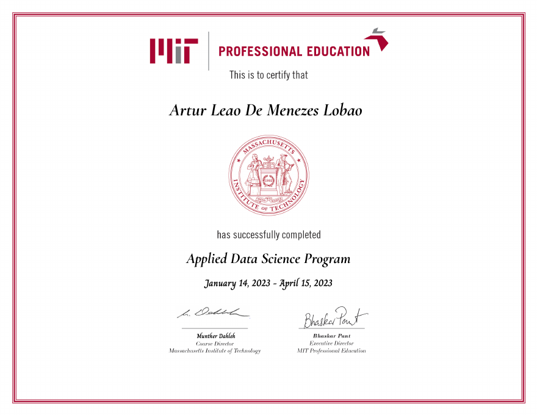

# MIT Applied Data Science Program

My project work from the **Applied Data Science Program** at **MIT Professional Education** (January 14 to April 15, 2023).

---

## Projects

| Project | Problem | Techniques |
|---|---|---|
| 🚗 [**Used Cars Price Prediction**](capstone-used-cars-price-prediction/) *(capstone)* | Price used cars for an Indian market start-up | EDA, feature engineering, Linear / Ridge / Lasso, Decision Tree, Random Forest, hyperparameter tuning |
| 🏠 [**Boston House Price Regression**](boston-house-price-regression/) | Predict median house value | OLS (statsmodels), multicollinearity (VIF), regression diagnostics, cross-validation |
| 🩺 [**Pima Indians Diabetes EDA**](pima-diabetes-eda/) | Explore diabetes risk factors | Descriptive statistics, distributions, outliers, correlation analysis |

## Stack

Python, pandas, NumPy, scikit-learn, statsmodels, matplotlib, seaborn, Jupyter

---

Course templates and datasets belong to MIT Professional Education and are not included. Notebooks contain my own solutions.
