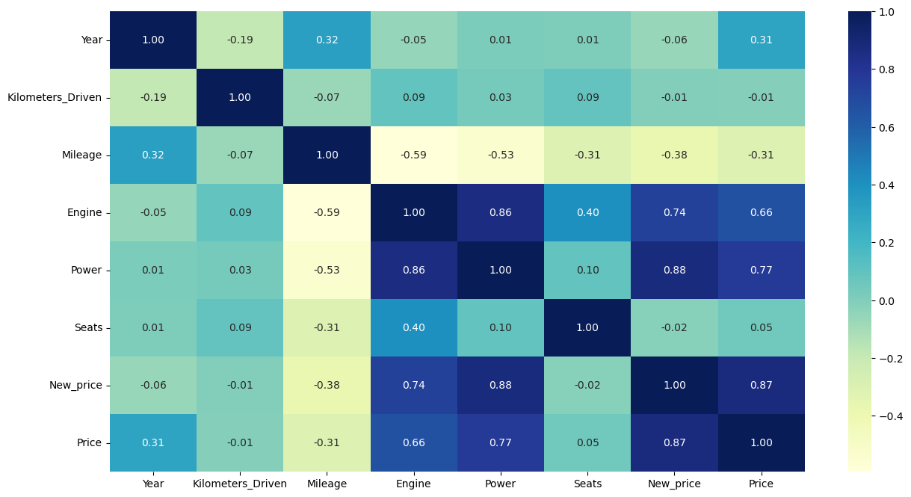
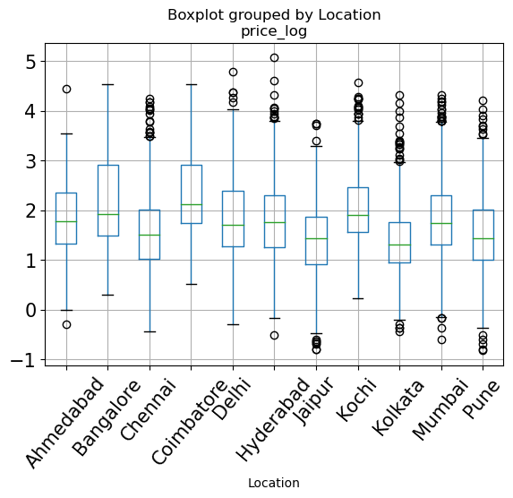

# Used Cars Price Prediction (Capstone)

Capstone project of the MIT Applied Data Science Program.

## Problem

Cars4U, a start-up entering the Indian used-car market, needs a pricing model. In 2018-19 around 4 million used cars changed hands versus 3.6 million new cars sold, and unlike new cars, used-car prices carry large uncertainty driven by brand, model, year, mileage and more.

**Goal:** find the variables that best explain used-car prices and build the best pricing model.

## Exploratory analysis

Correlation with `Price` (from the milestone report):

| Variable | Correlation |
|---|---|
| Power | 0.77 |
| Engine | 0.66 |
| Automatic transmission | 0.59 |
| Mercedes | 0.37 |
| Diesel | 0.32 |
| Year | 0.31 |
| Mileage | -0.31 |
| Kilometers driven | -0.01 |

Kilometers driven, commonly assumed to matter, showed almost no correlation with price.

## Feature selection

An OLS regression on log price kept only variables with p-value < 0.05: **Year, Mileage, Engine, Power, Automatic, Coimbatore (location), First owner, Diesel, Mercedes**.

## Model comparison

Metric: gap between train and test performance (lower is better).

| Model | Train-test gap |
|---|---|
| **Ridge / Lasso Regression** | **0.0033** |
| Decision Tree (tuned) | 0.0107 |
| Linear Regression | 0.0108 |
| Random Forest (tuned) | 0.0224 |
| Random Forest | 0.1957 |
| Decision Tree | 0.3497 |

**Selected model:** Lasso regression, with the smallest train-test gap.

## Files

| File | Contents |
|---|---|
| `used_cars_eda_feature_engineering.ipynb` | Data overview, univariate and bivariate EDA, feature engineering, missing-value treatment |
| `milestone_report.pdf` | Full write-up with variable selection and model comparison |

> Results above are taken from `milestone_report.pdf`. The notebook in this folder covers the EDA and feature engineering stage.
